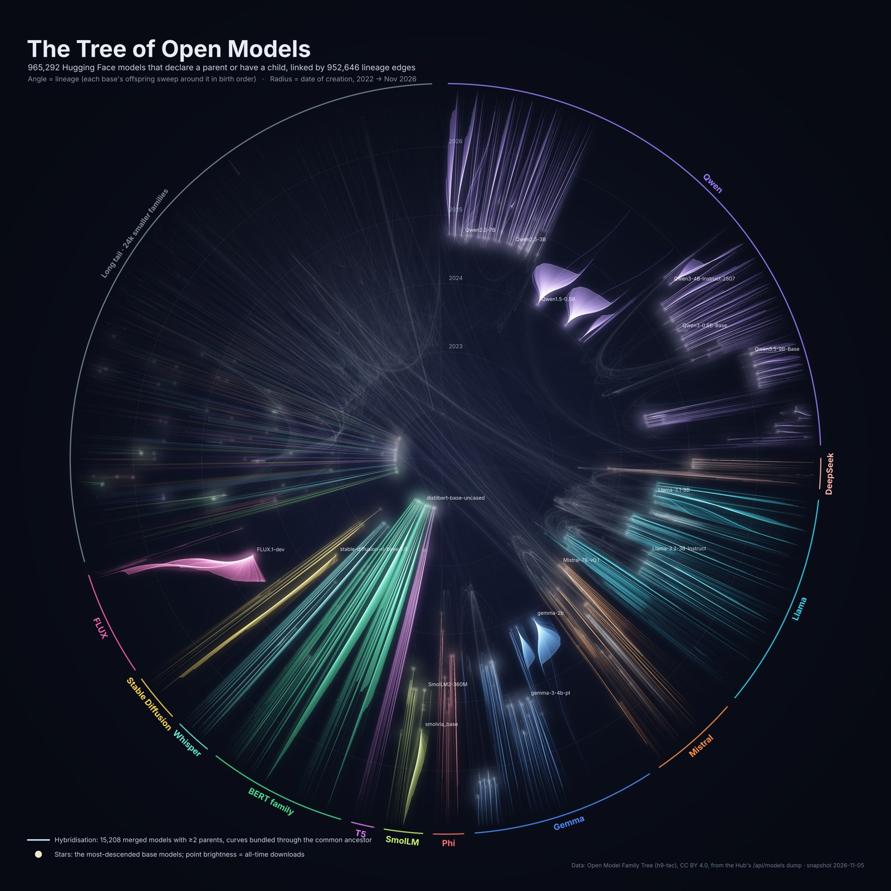
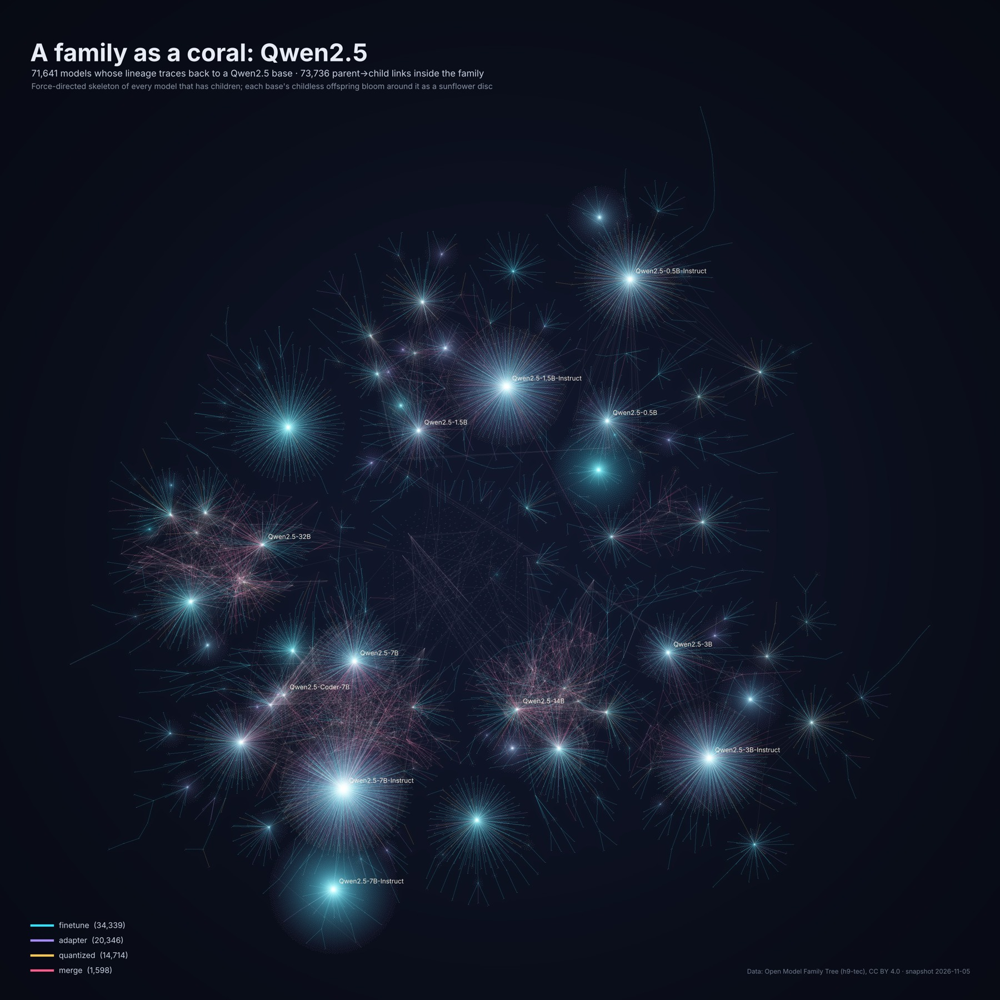
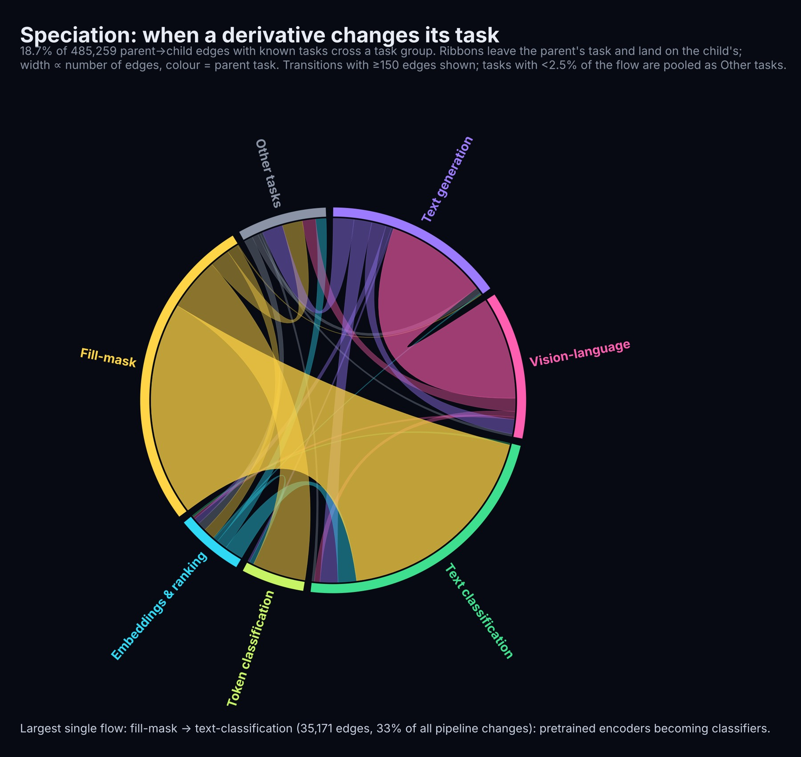
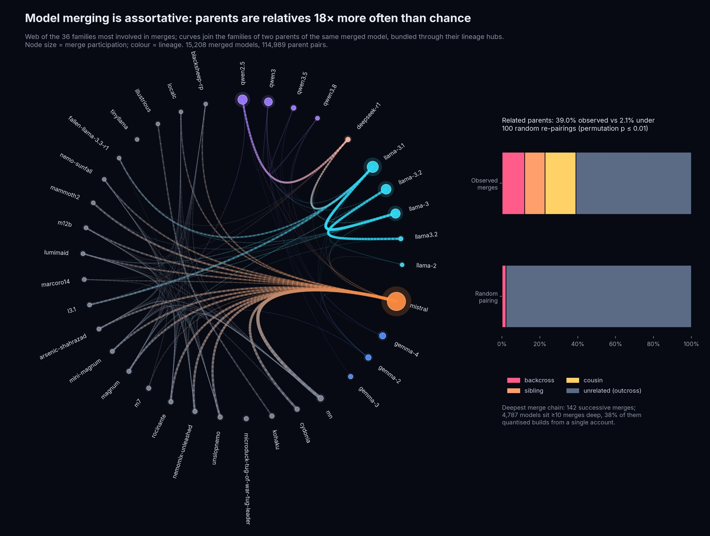
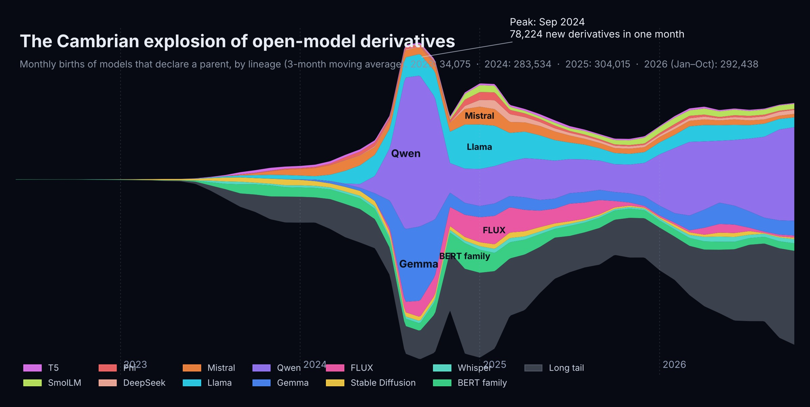

<p align="center"></p>

<h1 align="center">open-model-phylogeny</h1>

<p align="center"><b>Phylogenetics of Open Models: Structure, Hybridisation, Tempo and Speciation in the Hugging Face Lineage Graph</b><br>
Thanatchon Chongmankhong · Working draft, November 2026</p>


[](https://thanatchon36.github.io/open-model-phylogeny/paper/)
[](https://github.com/thanatchon36/open-model-phylogeny/raw/main/paper/paper.pdf)
[](https://doi.org/10.5281/zenodo.24029159)
[](https://huggingface.co/datasets/thanatchon36/open-model-phylogeny)
[](LICENSE)

📖 **[Read the paper online](https://thanatchon36.github.io/open-model-phylogeny/paper/)** ·
⬇️ **[Download the PDF](https://github.com/thanatchon36/open-model-phylogeny/raw/main/paper/paper.pdf)** ·
📊 **[Results](results/results.json)** ·
📝 **[Research plan](docs/MASTER_PROMPT.md)** ·
📓 **[Research log](docs/RESEARCH_LOG.md)** ·
🤗 **[Research data](https://huggingface.co/datasets/thanatchon36/open-model-phylogeny)**

**A phylogenetic atlas of the Hugging Face Hub, built from the lineage that models declare.**
Fine-tunes, adapters, quantisations and merges name their parents in `base_model`, which turns the Hub into a
population whose genealogy can be read. From a snapshot taken on 2026-11-05, this repository reconstructs the lineage
graph of 965,292 connected models and 952,646 parent-to-child links, and studies it with concepts borrowed from
phylogenetics.

- **Structure:** the top 1% of roots hold 74.8% of connected models (Gini 0.88), and 95.1% of derivatives never have
  offspring.
- **Hybridisation:** 39.0% of merged parent pairs are relatives, against 2.1% under random re-pairing.
- **Tempo:** for heavily reused bases, the median time to the first fine-tune fell from 35.1 days (2023 H2 releases)
  to 2.8 days (2026 H1 releases).
- **Attention:** the top 1% of uploaders produce 52.5% of derivatives, and the top 1% of derivatives receive 95.9% of
  their downloads.
- **Speciation:** 18.7% of parent-to-child links change task group, led by fill-mask to text classification.

<p align="center"></p>

## Install and quickstart

```bash
pip install -r requirements.txt   # Python 3.12, plus pdflatex for the paper
make data                         # fetch the pinned snapshot from Hugging Face if missing, verify against SHA256SUMS
make all                          # build -> analyze -> figures -> paper (about 10 min, ~2.5 GB RAM peak)
```

All random seeds are fixed at 42.

| `make` target | Purpose | Time |
|---|---|---|
| `data` | Fetch the pinned snapshot from Hugging Face if missing, then verify `data/raw` against `SHA256SUMS` | depends on network |
| `build` | Raw parquet to cleaned DAG: case-insensitive parents, ghost nodes, cycle breaking, primary tree, families | ~20 s |
| `analyze` | All statistics: `results/results.json` and `results/tables/*.csv` | ~90 s |
| `figures` | Radial layout and figures F1–F6 | ~5 min |
| `paper` | Generated macros, tables and numbers ledger, then `pdflatex` twice | |
| `all` | `build`, `analyze`, `figures`, `paper` | ~10 min |
| `web` | Web reader `docs/paper/` from the LaTeX source (needs pandoc) | |
| `arxiv` | arXiv upload bundle `paper/arxiv.tar.gz` (needs tectonic) | |
| `poster` | LinkedIn poster `docs/assets/linkedin_poster.png` from the F1 render and `results.json` | |
| `hf-dataset` | Assemble the Hugging Face dataset in `build/hf_dataset` | |
| `clean` | Remove processed data and LaTeX by-products | |

The raw snapshot is not committed. `make data` downloads it from the [Hugging Face dataset](https://huggingface.co/datasets/thanatchon36/open-model-phylogeny) at a fixed revision,
because upstream `data-latest` is rebuilt nightly and would not reproduce the paper.

## Research: *Phylogenetics of Open Models* (2026)

The paper is [`paper/paper.pdf`](paper/paper.pdf) (19 pages, November 2026 draft, arXiv-style preprint layout), with LaTeX source in
[`paper/paper.tex`](paper/paper.tex) and a [web version](https://thanatchon36.github.io/open-model-phylogeny/paper/) with the same text and numbers. It asks five questions of the lineage graph: how concentrated it is, who merges
with whom, how fast new bases are reused, where attention goes, and when a derivative changes task. Every number in
the paper is generated from `results/results.json` by `src/make_macros.py` and listed in the paper's numbers ledger.

| Coral (Qwen2.5) | Speciation | Hybridisation |
|---|---|---|
|  |  |  |

<p align="center"></p>

- All research data, including the raw snapshot and the processed graph: Hugging Face dataset
  [`thanatchon36/open-model-phylogeny`](https://huggingface.co/datasets/thanatchon36/open-model-phylogeny), built by `scripts/make_hf_dataset.py`
- Archived release: [doi:10.5281/zenodo.24029159](https://doi.org/10.5281/zenodo.24029159) (Zenodo)
- Single source of truth for all statistics: [`results/results.json`](results/results.json), with cleaning counts in
  [`results/build.json`](results/build.json)
- Tables behind the figures: [`results/tables/`](results/tables/)
- Figures used by the paper: [`paper/figs/`](paper/figs/)
- Decisions and why they were made: [`docs/RESEARCH_LOG.md`](docs/RESEARCH_LOG.md)

Each figure script can also be run on its own. F1 at 5000 px peaks near 2.5 GB of RAM, so use a smaller size for
drafts:

```bash
cd src
python fig_hero.py 1600 all     # F1 radial chronogram: <px> <all|collapsed>
python fig_flows.py             # F3 speciation chord, F4 streamgraph
python fig_more.py              # F2 coral, F5 hybridisation web, F6 statistics panel
```

## Repository layout

```
assets/hero_preview.jpg   preview of F1 used in this README
data/raw/SHA256SUMS       checksums of the pinned snapshot (the data files are git-ignored and live on Hugging Face)
src/
  common.py       super-family regexes, palettes, task groups, fonts
  build.py        raw parquet -> cleaned DAG; documents the cycle-breaking and primary-parent rules
  analyze.py      all statistics -> results/results.json and results/tables/*.csv
  layout.py       radial chronogram layout (angle = lineage, radius = creation date)
  fig_hero.py     F1, custom additive rasteriser
  fig_flows.py    F3 speciation chord, F4 streamgraph
  fig_more.py     F2 coral, F5 hybridisation web, F6 statistics panel
  make_macros.py  results.json -> paper/macros.tex, tables, numbers ledger, paper/figs/*.jpg
results/          results.json, build.json and the tables behind the figures
paper/            LaTeX source, generated macros and tables, figures, web reader template, paper.pdf
scripts/          get_data.sh (fetch and verify the snapshot), build_web_paper.py (web reader), make_hf_dataset.py (Hugging Face data)
docs/             web reader (docs/paper/, served by GitHub Pages), research plan, research log, dataset card, LinkedIn post and poster, logo
CLAUDE.md         instructions and next steps for Claude Code
```

## Honesty and limitations

This is a working draft. The pipeline, figures and first draft of the paper were produced with the assistance of
Claude (Anthropic), and the author is responsible for verifying them. Every reference was checked on 2026-11-06 against
Crossref, arXiv or the publisher's own source; two are still arXiv preprints.

The license-drift analysis of the original plan is not done, because the snapshot has no per-model license tags.
The graph covers declared ancestry only, so all counts are lower bounds, and relation labels may be inferred or wrong.
Family keys rely on a naming heuristic, and download counts include automated traffic. Creation time is not release
time, and the creation date 2022-03-02 is a Hub backfill, treated as left-censored. Faster reaction times could partly
reflect wider adoption of declarations: restricting the test to bases released from 2024 onwards preserves the trend,
except for merges. Family sizes are reported as heavy-tailed rather than as a power law, because the comparison with a
lognormal is inconclusive. The study uses public metadata only and covers one platform at one point in time.

## Next steps

1. License drift: collect per-model license tags, propagate obligations down the lineage, and audit a stratified
   sample by hand.
2. Paper polish: venue template and page limit.
3. Interactive explorer of the graph.

## Data and attribution

Lineage data: [Open Model Family Tree](https://github.com/h9-tec/model-family-tree) by h9-tec, release `data-latest`
(CC BY 4.0), derived from the [`cfahlgren1/hub-stats`](https://huggingface.co/datasets/cfahlgren1/hub-stats) dump of
Hugging Face Hub metadata (Apache-2.0). Our copy and the derived files are in the
[Hugging Face dataset](https://huggingface.co/datasets/thanatchon36/open-model-phylogeny), also under CC BY 4.0.

## Citation

See [`CITATION.cff`](CITATION.cff). Code license: MIT. Data: CC BY 4.0, as above.

```bibtex
@unpublished{chongmankhong2026phylogeny,
  author = {Chongmankhong, Thanatchon},
  title  = {Phylogenetics of Open Models: Structure, Hybridisation, Tempo and Speciation in the {Hugging Face} Lineage Graph},
  note   = {Working draft and code repository},
  year   = {2026},
  doi    = {10.5281/zenodo.24029159},
  url    = {https://github.com/thanatchon36/open-model-phylogeny}
}
```
